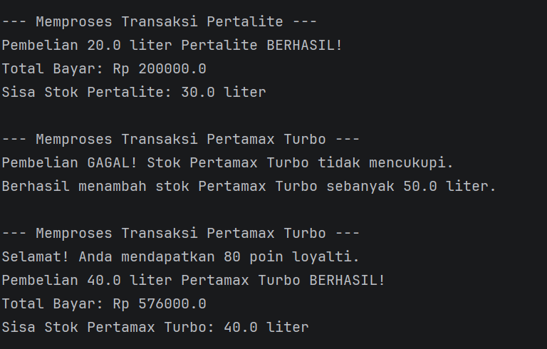
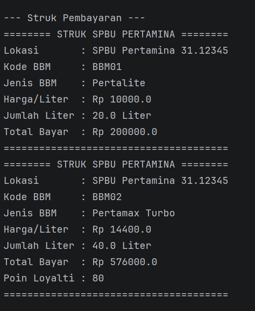

# Responsi Akhir PBO - Sistem Pengisian BBM SPBU

## 1. Identitas Mahasiswa & Tema NIM
* **Nama** : Revina Albaini Nur Islami
* **NIM**  : H1D025073
* **Tema** : SPBU 

## 2. Petunjuk Compile dan Run

1. Buka terminal atau Command Prompt di folder proyek.
2. Kompilasi seluruh kode sumber Java ketik :
   javac *.java (lalu setelah itu ketik)
   java Main

## 3. Luaran Program

